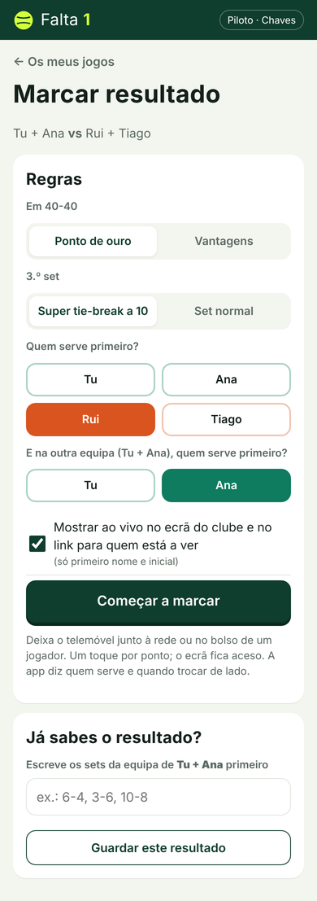
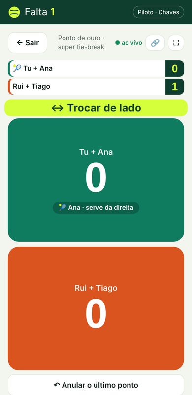
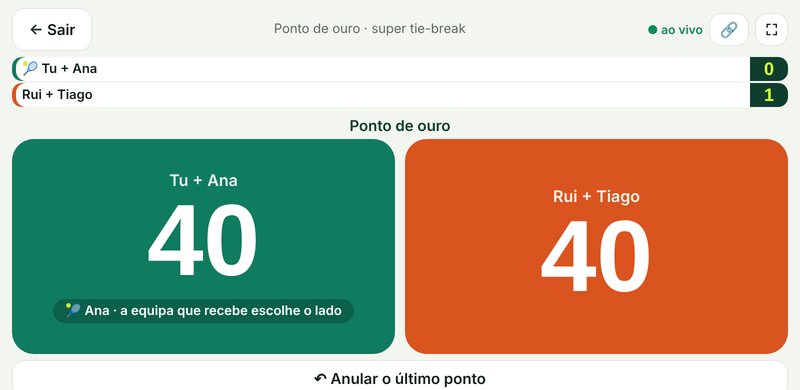
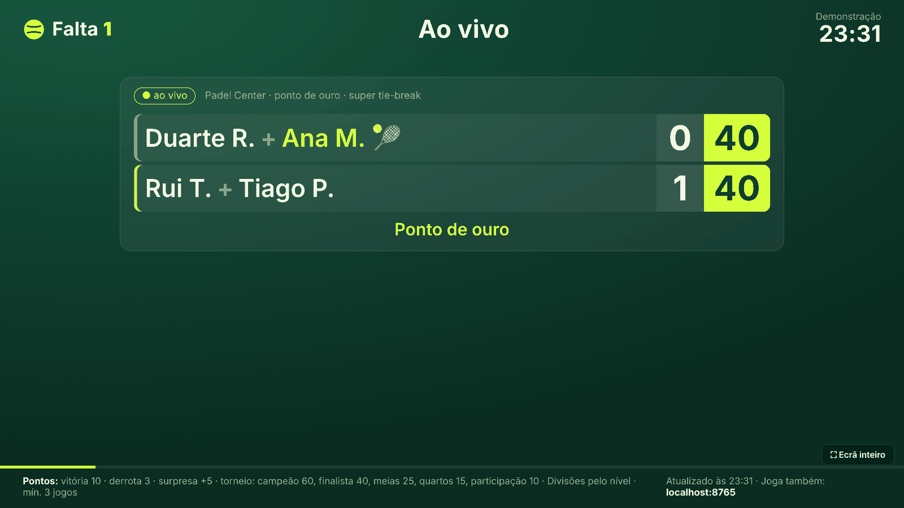
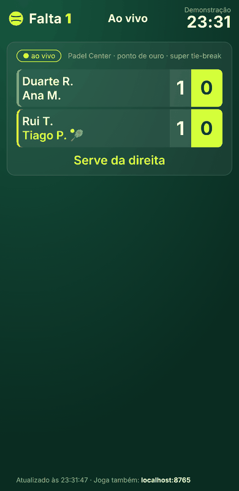

# Marcador ao vivo

Em "Os meus jogos" → **Marcar resultado**. Código: `js/scorer.js` (regras), `js/app.js` (ecrã do marcador), `js/ecra.js` (ecrã do clube e link), `supabase/schema.sql` (tabela `live_scores`). Testes: `node tests/scorer.test.js`.

## Antes de começar

- **Em 40-40:** ponto de ouro ou vantagens.
- **3.º set:** super tie-break a 10 ou set normal.
- **Quem serve primeiro:** escolhe-se o jogador que começa e, na outra equipa, quem serve primeiro dessa equipa.
- **Mostrar ao vivo:** ligado por defeito, pode desligar-se. Aparecem só o primeiro nome e a inicial.
- Também se pode escrever o resultado à mão (ex.: `6-4, 3-6, 10-8`).

## Durante o jogo

- Um toque por ponto, com botão de anular. O ecrã fica aceso e o marcador sobrevive a um recarregar da página.
- **Quem serve** aparece no botão da equipa e na tabela (🎾):
  - o serviço roda pelos 4: 1.º da equipa que começa, 1.º da outra, 2.º da que começa, 2.º da outra;
  - no tie-break, 1 ponto e depois 2 cada; quem recebeu primeiro no tie-break serve no set seguinte;
  - serve-se da **direita** com os pontos do jogo pares e da **esquerda** com ímpares;
  - no ponto de ouro, lembra que é a equipa que recebe que escolhe.
- **Troca de lado:** faixa grande e vibração depois dos jogos ímpares de cada set (1, 3, 5…), a cada 6 pontos no tie-break e no fim de um set com número ímpar de jogos (ex.: 6-3, 7-6).
- **Horizontal:** ao rodar o telemóvel, os botões ficam lado a lado.
- **Ecrã inteiro (⛶):** em Android e no computador. No iPhone o botão não aparece: o Safari não deixa, mas a app instalada já ocupa o ecrã todo.

## No fim

**Guardar resultado** → a outra equipa confirma ou contesta. Só os resultados confirmados contam para o nível e para a época.

## Ao vivo

- Cada toque envia o estado completo do jogo (o último envio ganha). No topo aparece **● ao vivo**, ou **○ sem rede** se o envio falhar. O marcador continua a funcionar sem rede e volta a enviar no ponto seguinte.
- **Ecrã do clube (`ecra.html`):** quando há jogos a ser marcados, aparece primeiro o ecrã "Ao vivo", com até 4 jogos, atualizado a cada 5 s. `?clube=cpc` mostra só os jogos desse clube, e `&so=aovivo` fixa esse ecrã.
- **Link para quem está a ver (🔗):** `ecra.html?jogo=ID` mostra só esse jogo, em grande. Funciona também no telemóvel e atualiza a cada 3 s.

## Segurança e privacidade (Supabase)

- Tabela `live_scores`: ninguém lê nem escreve diretamente.
- `push_live_score`: só os 4 jogadores do jogo, com o jogo confirmado, no dia do jogo (com 1 dia de folga por causa dos fusos horários). Aceita só pontos `a`/`b` (até 600) e uma configuração pequena.
- `clear_live_score`: só os jogadores do jogo.
- `public_live_scores`: pública (sem conta). Devolve só os jogos atualizados nos últimos 20 minutos, com o nome curto, e respeita a opção "aparecer no ranking da TV" do perfil.
- Em modo demonstração, tudo fica no `localStorage`. O ecrã do clube só vê o marcador se estiver aberto no mesmo browser.

## Pôr a funcionar no piloto real

1. Supabase → SQL Editor → correr outra vez o `supabase/schema.sql` inteiro (é seguro e não mexe nos dados).
2. Commit e push.
